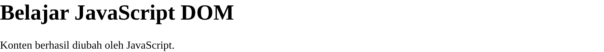
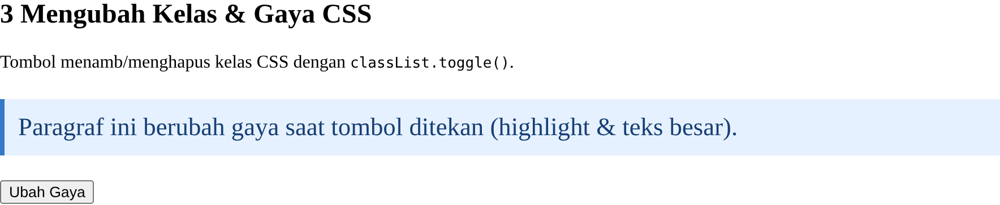
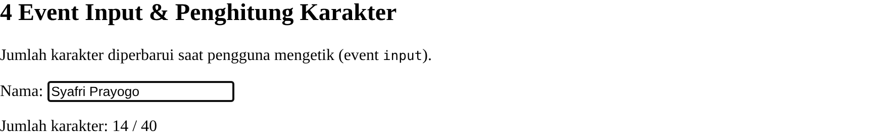
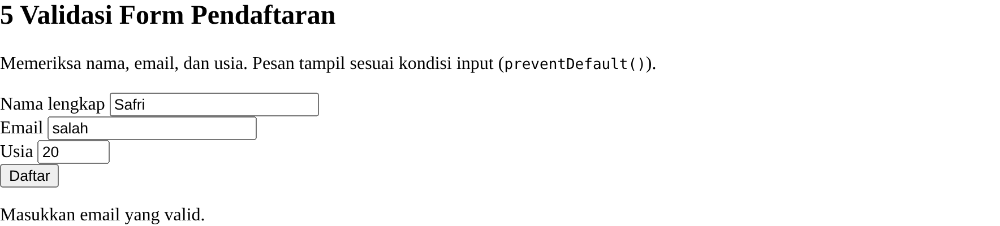
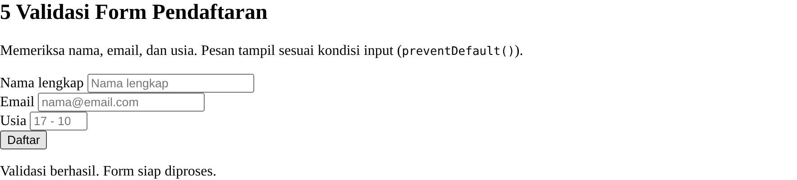
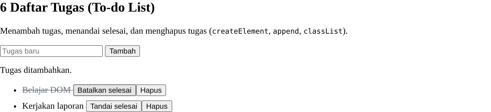
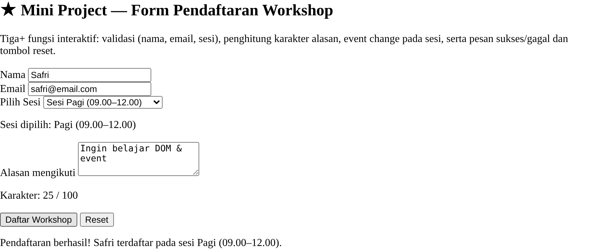
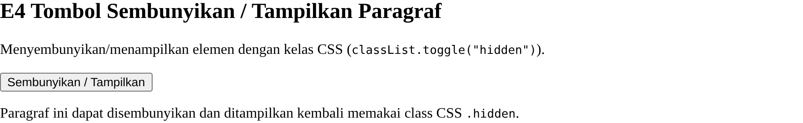
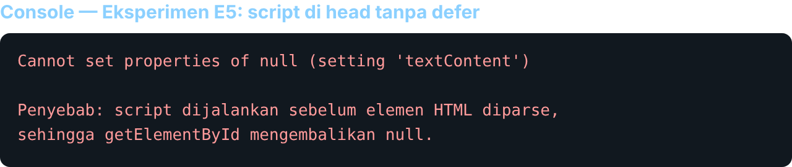

# Laporan Praktikum 6 — JavaScript DOM dan Event Handling

**Mata Kuliah:** Pemrograman Web (Pertemuan 7) <br>
**Dosen Pengampu:** Agung Nugroho <br>
**Universitas Pelita Bangsa** — Fakultas Teknik — Teknik Informatika

| Keterangan | Isi |
|---|---|
| Nama | Syafri Prayogo |
| NIM | 312510500 |
| Kelas | TI.25.C.3 |
| Program Studi | Teknik Informatika |

---

## 1. Tujuan Praktikum

1. Memahami DOM sebagai representasi dokumen HTML yang dapat diakses melalui JavaScript.
2. Menggunakan id, class, dan selector CSS untuk memilih elemen HTML.
3. Mengubah teks, atribut, kelas CSS, dan gaya elemen melalui JavaScript.
4. Menangani event pengguna menggunakan `addEventListener()`.
5. Membuat validasi form dan menampilkan pesan sesuai kondisi input.
6. Mengembangkan halaman interaktif dengan minimal tiga fungsi yang berjalan benar.

## 2. Dasar Teori

**DOM (Document Object Model)** merepresentasikan struktur dokumen HTML dalam bentuk objek yang dapat diakses dan dimanipulasi oleh JavaScript.

- **Memilih elemen:** `getElementById()` (berdasarkan id), `querySelector()` (elemen pertama yang cocok dengan selector CSS), `querySelectorAll()` (semua elemen yang cocok).
- **Mengubah konten/atribut:** `textContent` (teks biasa, lebih aman), `innerHTML` (markup — hindari untuk input pengguna karena risiko keamanan), `setAttribute()`.
- **Event & listener:** `addEventListener("click"/"input"/"change"/"submit", fn)` menghubungkan event dengan fungsi.
- **Validasi form:** memeriksa input sebelum diproses; `event.preventDefault()` mencegah halaman dimuat ulang saat submit.
- **Kelas CSS:** `classList.add()`, `classList.remove()`, `classList.toggle()`.

Atribut `defer` pada `<script>` membuat JavaScript dijalankan setelah HTML selesai di-parse, sehingga elemen yang dipilih sudah tersedia.

## 3. Struktur File & Cara Menjalankan

```
lab6_dom_event/
├── index.html    # kerangka halaman + elemen tiap latihan
├── style.css     # gaya tampilan & kelas (.highlight, .teks-besar, .selesai, .hidden)
└── script.js     # pemilihan elemen, event listener, validasi (dihubungkan dengan defer)
```

Jalankan `index.html` di browser (ketiga file harus satu folder), lalu aktifkan **Developer Tools → Console** untuk memeriksa hasil.

---

## 4. Langkah Kerja & Hasil

### Latihan 1 — Mengubah Teks dengan DOM

```javascript
const judul = document.getElementById("judul");
const pesan = document.getElementById("pesan");
judul.textContent = "Belajar JavaScript DOM";
pesan.textContent = "Konten berhasil diubah oleh JavaScript.";
```



> *Gambar L1 — Judul dan paragraf pada header berubah setelah dipilih dengan `getElementById` dan diubah `textContent`.*

### Latihan 2 — Event Click

```javascript
const tombol = document.getElementById("tombolAksi");
tombol.addEventListener("click", function () {
    pesan.textContent = "Tombol diklik pada " + new Date().toLocaleTimeString();
});
```


> *Gambar L2 — Saat tombol diklik, paragraf menampilkan waktu tindakan.*

### Latihan 3 — Mengubah Kelas & Gaya CSS

```javascript
tombolGaya.addEventListener("click", function () {
    teksGaya.classList.toggle("highlight");
    teksGaya.classList.toggle("teks-besar");
});
```



> *Gambar L3 — `classList.toggle()` menamb/menghapus kelas `highlight` dan `teks-besar`.*

### Latihan 4 — Event Input & Penghitung Karakter

```javascript
namaInput.addEventListener("input", function () {
    jumlahKarakter.textContent = namaInput.value.length;
});
```



> *Gambar L4 — Jumlah karakter diperbarui saat pengguna mengetik.*

### Latihan 5 — Validasi Form Pendaftaran

```javascript
form.addEventListener("submit", function (event) {
    event.preventDefault();
    const nama = document.getElementById("nama").value.trim();
    const email = document.getElementById("email").value.trim();
    const usia = Number(document.getElementById("usia").value);
    const polaEmail = /^[^\s@]+@[^\s@]+\.[^\s@]+$/;
    if (nama === "") { /* Nama wajib diisi */ }
    else if (!polaEmail.test(email)) { /* email tidak valid */ }
    else if (!Number.isInteger(usia) || usia < 17 || usia > 100) { /* usia 17-100 */ }
    else { /* Validasi berhasil */ form.reset(); }
});
```



> *Gambar L5a — Kondisi tidak valid: email salah → "Masukkan email yang valid.".*



> *Gambar L5b — Semua input valid → "Validasi berhasil. Form siap diproses." dan form di-reset.*

### Latihan 6 — Daftar Tugas (To-do List)

```javascript
tambahTugas.addEventListener("click", function () {
    const teks = inputTugas.value.trim();
    if (teks === "") { pesanTugas.textContent = "Tulis tugas terlebih dahulu."; return; }
    const item = document.createElement("li");
    const label = document.createElement("span");
    const selesai = document.createElement("button");
    label.textContent = teks + " ";
    selesai.textContent = "Tandai selesai";
    selesai.addEventListener("click", function () {
        item.classList.toggle("selesai");
        selesai.textContent = item.classList.contains("selesai") ? "Batalkan selesai" : "Tandai selesai";
    });
    item.append(label, selesai);
    daftarTugas.appendChild(item);
    inputTugas.value = "";
});
```



> *Gambar L6 — Menambah tugas, menandai selesai (teks dicoret), dan menghapus tugas (tombol Hapus — Eksperimen E1).*

---

## 5. Mini Project — Form Pendaftaran Workshop

Halaman pendaftaran dengan **empat fungsi interaktif**: (1) penghitung karakter alasan (event `input`), (2) event `change` pada dropdown sesi, (3) validasi submit (nama minimal 3 karakter, email valid, sesi dipilih) dengan `preventDefault()`, dan (4) tombol reset. Pesan error dan sukses tampil di halaman.

```javascript
formWorkshop.addEventListener("submit", function (event) {
    event.preventDefault();
    const nama = document.getElementById("wNama").value.trim();
    const email = document.getElementById("wEmail").value.trim();
    const sesi = wSesi.value;
    const polaEmail = /^[^\s@]+@[^\s@]+\.[^\s@]+$/;
    if (nama.length < 3) { /* Nama minimal 3 karakter */ }
    else if (!polaEmail.test(email)) { /* email tidak valid */ }
    else if (sesi === "") { /* pilih sesi */ }
    else { /* Pendaftaran berhasil */ }
});
```



> *Gambar MP — Form workshop: penghitung karakter (25/100), sesi terpilih (event change), dan pesan sukses.*

---

## 6. Eksperimen Mandiri (Bagian G)

- **E1 — Tombol hapus item To-do.** Setiap item memiliki tombol **Hapus** (`daftarTugas.removeChild(item)`) — lihat Gambar L6.
- **E2 — Validasi nama minimal 3 karakter.** Diterapkan pada Mini Project (`nama.length < 3`).
- **E3 — Event change pada dropdown sesi.** Menampilkan sesi yang dipilih — lihat Gambar MP ("Sesi dipilih: …").
- **E4 — Tombol sembunyikan/tampilkan paragraf** dengan kelas CSS:

```javascript
tombolToggle.addEventListener("click", function () {
    paragrafToggle.classList.toggle("hidden");
});
```



> *Gambar E4 — Paragraf dapat disembunyikan/ditampilkan dengan `classList.toggle("hidden")`.*

- **E5 — Script tanpa `defer` di `<head>`.** Saat `<script>` diletakkan di `<head>` tanpa `defer`, kode berjalan sebelum elemen HTML diparse sehingga `getElementById` mengembalikan `null` dan terjadi error:



> *Gambar E5 — Error `Cannot set properties of null` karena elemen belum tersedia. Solusi: gunakan `defer` atau letakkan `<script>` menjelang akhir `<body>`.*

---

## 7. Jawaban Pertanyaan Evaluasi

**1. Apa itu DOM dan manfaatnya?**
DOM (Document Object Model) adalah representasi struktur dokumen HTML dalam bentuk objek yang dapat diakses JavaScript. Manfaatnya: program dapat memilih elemen, mengubah konten/atribut/gaya, menambah/menghapus elemen, dan merespons tindakan pengguna sehingga halaman menjadi interaktif.

**2. Perbedaan `getElementById()`, `querySelector()`, dan `querySelectorAll()`.**
`getElementById("id")` memilih satu elemen berdasarkan id. `querySelector("selector")` memilih **elemen pertama** yang cocok dengan selector CSS. `querySelectorAll("selector")` memilih **semua** elemen yang cocok (mengembalikan NodeList).

**3. Fungsi `addEventListener()` dan tiga contoh event.**
`addEventListener(event, fungsi)` menghubungkan sebuah event dengan fungsi yang dijalankan saat event terjadi. Contoh event: `click` (tombol diklik), `input` (nilai input berubah saat mengetik), `change` (pilihan dropdown berubah), `submit` (form dikirim).

**4. Mengapa `event.preventDefault()` digunakan pada submit form?**
Agar perilaku bawaan form (memuat ulang/mengirim halaman ke server) tidak terjadi, sehingga validasi dan penanganan data dapat dilakukan oleh JavaScript tanpa halaman ter-refresh.

**5. Perbedaan `textContent` dan `innerHTML` (penggunaan & keamanan).**
`textContent` mengisi/membaca teks biasa — tag HTML tidak dieksekusi, sehingga lebih aman untuk menampilkan input pengguna. `innerHTML` menafsirkan string sebagai markup HTML; jika diisi teks pengguna yang tidak dipercaya dapat menimbulkan risiko keamanan (XSS). Gunakan `textContent` untuk teks pengguna.

**6. Bagaimana `classList.toggle()` membantu mengubah tampilan elemen?**
`classList.toggle("kelas")` menambahkan kelas jika belum ada dan menghapusnya jika sudah ada. Dengan satu pemanggilan, tampilan elemen (warna, ukuran, tampil/sembunyi) dapat di-on/off-kan tanpa menulis gaya inline berulang.

**7. Tiga skenario pengujian validasi form.**
(a) Semua kolom kosong → "Nama wajib diisi."; (b) Email tidak valid (mis. "salah") → "Masukkan email yang valid."; (c) Usia di bawah 17 → "Usia harus berupa bilangan bulat 17-100."; (d) Semua input valid → "Validasi berhasil. Form siap diproses.".

---

## 8. Struktur Output Repository

```
Lab6Web/
├── lab6_dom_event/
│   ├── index.html
│   ├── style.css
│   └── script.js
├── screenshots/      # hasil screenshot tiap latihan (valid & tidak valid)
└── README.md         # laporan / dokumentasi praktikum
```

## 9. Kesimpulan

Praktikum 6 menerapkan manipulasi **DOM** dan **event handling**: memilih elemen (`getElementById`), mengubah teks/kelas/gaya (`textContent`, `classList`), serta menangani event (`click`, `input`, `change`, `submit`) dengan `addEventListener`. Validasi form memakai `preventDefault()` dan menampilkan pesan sesuai kondisi, sementara To-do List memakai `createElement`/`append`. Mini Project Form Pendaftaran Workshop menggabungkan empat fungsi interaktif yang berjalan benar. Seluruh latihan diuji pada browser tanpa error, dan eksperimen E5 menegaskan pentingnya `defer` agar elemen tersedia saat script dijalankan.
